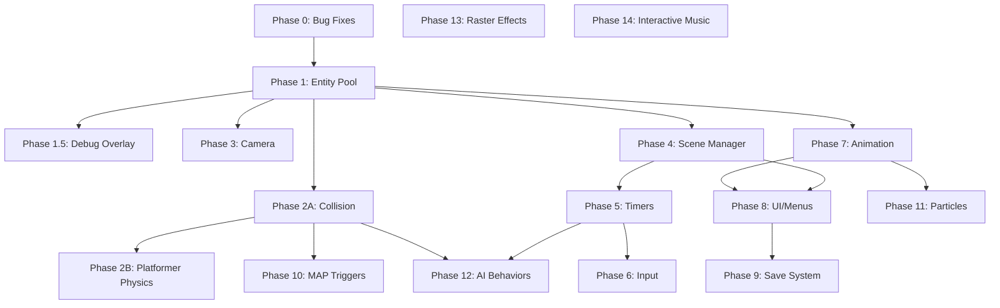

# SGDK Enhancement Roadmap

Combined plan for upstream bug fixes and new engine features. Every module is a **composable building block** — mix and match freely. No module assumes or excludes a genre.

---

## Phase 0 — Bug Fixes

Quick wins that fix real issues and build familiarity with SGDK internals.

| Task | Issue | Status | Notes |
|------|-------|--------|-------|
| Rescomp: Tiled object templates | [#466](https://github.com/Stephane-D/SGDK/issues/466) | **Done** | Full .tx loading, attribute/property merging |
| Team Player auto-detect fix | [#326](https://github.com/Stephane-D/SGDK/issues/326) | **Done** | Independent per-port detection in `JOY_reset()` |
| Tilemap flip functions | [#461](https://github.com/Stephane-D/SGDK/issues/461) | **Done** | `VDP_setTileMapDataRectFlipped()` + wrapper |
| Retro-Bit controller timing | [#363](https://github.com/Stephane-D/SGDK/issues/363) | **Blocked** | Needs real hardware to tune timing |

---

## Phase 1 — Entity Pool System

> Fixed-size entity pool — the foundation everything else builds on.

- Fixed-size pool with O(1) alloc/free (free-list)
- Component-style data attachment (position, velocity, sprite, collision, custom)
- Iteration primitives: `ENTITY_forEach(mask, callback)`
- Automatic sprite engine integration: spawn → sprite allocated, kill → sprite released
- Pool stats API for profiling (active count, high watermark)

**Depends on:** Nothing — foundational system.

---

## Phase 1.5 — Debug & Profiling Overlay

> Build profiling tools BEFORE the systems you need to profile.

- On-screen CPU usage bar (cycles per frame, percentage)
- Entity count, free RAM, DMA queue depth display
- Hitbox/collision visualization toggle
- Compile-time `#ifdef DEBUG` — zero overhead in release builds
- KLog integration for serial debugging

**Depends on:** Phase 1 (entity stats).

---

## Phase 2A — Collision System (Genre-Agnostic Core)

> Universal collision detection layer usable by ANY game type.

- **Spatial grid** — configurable cell size, O(1) insert/remove, neighbor queries
- **Tilemap collision** — per-tile type flags (solid, slope, one-way, empty, custom). `COL_checkTile(x, y)` → tile type + penetration vector
- **Entity-vs-entity** — AABB and circle overlap tests via spatial grid
- **Collision layers/masks** — enemies don't collide with each other, bullets hit enemies but not player, etc.
- `COL_moveAndSlide(entity, velocity)` — generic movement with collision response

**Depends on:** Phase 1.

---

## Phase 2B — Platformer Physics Module (Optional Addon)

> Platformer-specific behaviors layered on top of Phase 2A. **Not linked unless used.**

- fix16 gravity, acceleration, deceleration, max velocity profiles
- Slope snapping, ceiling bonk, coyote time, variable jump height
- Wall/floor/ceiling sensor system (SMW-style)
- State machine: grounded, airborne, wall-slide, swimming, climbing
- Configurable physics profiles (swap between ground/air/water/ice constants)

**Depends on:** Phase 2A.

---

## Phase 3 — Camera System

> Reusable camera with common 2D behaviors. Genre-agnostic by design.

- Smooth lerp follow with configurable speed and dead zones
- Screen shake with decay
- Room/section locking with transition animations
- **Platformer preset:** Snap-to-ground, directional bias, L/R look-ahead
- **Top-down preset:** Centered follow with edge push

**Depends on:** Phase 1.

---

## Phase 4 — Scene & State Manager

> Title → gameplay → pause → game over. Every game needs this.

- Scene stack with push/pop (pause overlay, nested menus)
- Per-scene `init()`, `update()`, `draw()`, `destroy()` callbacks
- Transition effects (fade, wipe, iris) with configurable timing
- Scene-scoped resource loading/unloading
- Global state preserved across scene changes (score, lives, inventory)

**Depends on:** Phase 1 (entity lifecycle per-scene cleanup).

---

## Phase 5 — Timer & Scheduler System

> Stop rolling frame counters by hand.

- `TIMER_after(frames, callback)` — one-shot delayed callback
- `TIMER_every(frames, callback)` — repeating periodic callback
- `TIMER_cooldown(id, frames)` — named cooldown with `TIMER_isReady(id)` check
- Pause-aware (timers freeze when scene is paused)
- Lightweight — fixed-size timer pool, zero heap allocation

**Depends on:** Phase 4 (pause-awareness from scene manager).

---

## Phase 6 — Input Abstraction

> Beyond raw joypad reads.

- Action mapping: bind physical buttons to logical actions (`ACTION_JUMP`, `ACTION_ATTACK`)
- Input buffering with configurable window (critical for action games)
- `INPUT_justPressed()`, `INPUT_held()`, `INPUT_released()` per action
- Combo detection (sequence of actions within time window)
- Remapping support (accessibility, player preference)

**Depends on:** Phase 5 (timing for buffer windows and combos).

---

## Phase 7 — Animation Controller

> Data-driven animation beyond raw sprite frames.

- Animation sequences defined as resource data (frame indices, durations, loop mode)
- Frame callbacks: trigger logic on specific frames (attack frame → spawn hitbox)
- Transition rules: which animations can interrupt which
- Blend/chain support: attack → attack-recovery → idle
- `ANIM_play(entity, animId)`, `ANIM_isFinished(entity)`, `ANIM_getFrame(entity)`

**Depends on:** Phase 1 (entity attachment).

---

## Phase 8 — UI & Menu System

> Every game ships with menus. Build them once.

- Widget primitives: label, selector, toggle, slider, progress bar
- Menu stack with cursor navigation (D-pad) and confirm/cancel
- HUD layer (fixed-position elements, auto-updating from game state)
- Dialog box with typewriter text, portraits, and player choices
- Window plane integration for overlay UI without disturbing BG_A/BG_B

**Depends on:** Phase 4 (scene manager for menu scenes), Phase 7 (animated UI elements).

---

## Phase 9 — Save System (SRAM)

> Structured save/load that handles the real-world edge cases.

- Versioned save slots with magic number + checksum validation
- `SAVE_write(slot, data, size)` / `SAVE_read(slot, data, size)`
- Corruption detection and recovery (fallback to defaults)
- Save slot management UI integration (Phase 8)
- Migration support: load v1 save in v2 game with field additions

**Depends on:** Phase 8 (save slot UI).

---

## Phase 10 — MAP Engine v2 (Trigger System)

> Extend SGDK's MAP scrolling engine with Tiled object layer events.

- Parse Tiled object layers via rescomp into trigger arrays
- Runtime trigger detection: `MAP_checkTriggers(x, y)` → callback dispatch
- Trigger types: enter/exit zones, touch-once, repeatable, directional
- Entity spawn points embedded in map data
- Dynamic tile manipulation: `MAP_setTile(x, y, newTile)` for ? blocks, breakable bricks

**Depends on:** Phase 1, Phase 2A.

---

## Phase 11 — Particle System

> Lightweight pooled particles — thin layer on Entity Pool.

- Dedicated particle pool (separate from gameplay entities, higher count, smaller struct)
- Emitter presets: burst, stream, cone, ring
- Per-particle: position, velocity, lifetime, gravity, fade, animation
- `PARTICLE_emit(emitter, x, y, count)` — fire and forget
- Auto-recycle on lifetime expiry

**Depends on:** Phase 1 (pool pattern), Phase 7 (particle animation).

---

## Phase 12 — AI Behavior Primitives

> Common enemy/NPC behaviors as composable building blocks.

- Patrol: walk between waypoints, pause at endpoints
- Chase/flee: move toward/away from target entity
- State machine framework: define states + transitions as data
- Line-of-sight check via tilemap collision (Phase 2A)
- Spawner pattern: emit entities on timer or trigger

**Depends on:** Phase 2A (collision for LOS), Phase 5 (timers for patrol delays).

---

## Phase 13 — Raster Effects Framework

> Declarative HBlank interrupt chaining for per-scanline effects.

- `RASTER_addEffect(startLine, endLine, callback)`
- Automatic HInt setup, priority sorting, minimal overhead when idle
- Built-in library: scroll wave, palette gradient, split-screen, water reflection
- Safe integration with VDP/DMA

**Depends on:** Nothing technically, but lower priority than gameplay systems.

---

## Phase 14 — Interactive Music (XGM2 Extension)

> Context-sensitive music on top of XGM2.

- Beat-synced section transitions (verse → chorus on next bar boundary)
- Channel layering: add/remove instrument tracks dynamically
- Stinger overlay (coin sound over music without interrupting)
- Music state machine: define transitions in resource files

**Depends on:** Deep understanding of XGM2 Z80 driver internals.

---

## Module Composability

Genres blend. Pick what your game needs.

| Module | What it gives you |
|--------|-------------------|
| Entity Pool (1) | Object lifecycle — **every game needs this** |
| Debug Overlay (1.5) | Dev-time profiling — **use during all development** |
| Spatial Grid (2A) | Fast entity-vs-entity queries |
| Tilemap Collision (2A) | Solid world geometry |
| Platformer Physics (2B) | Gravity, slopes, jump arcs — opt-in |
| Camera (3) | Smooth scrolling with presets |
| Scene Manager (4) | Game flow, transitions, pause |
| Timers (5) | Cooldowns, delays, periodic events |
| Input (6) | Button mapping, buffering, combos |
| Animation (7) | Data-driven frame sequences |
| UI/Menus (8) | HUD, dialogs, menu navigation |
| Save System (9) | SRAM with checksums and versioning |
| MAP Triggers (10) | Data-driven level events |
| Particles (11) | Fire-and-forget visual effects |
| AI Behaviors (12) | Patrol, chase, state machines |
| Raster Effects (13) | Per-scanline VDP tricks |
| Interactive Music (14) | Context-reactive audio |

> [!TIP]
> **Survivor/RPG hybrid:** Entity Pool + Spatial Grid + Tilemap Collision + Camera + Scene Manager + Timers + Input + Animation + UI + Save + MAP Triggers + Particles + AI Behaviors. No platformer physics needed.

---

## Dependency Graph

---

## Principles

- **Building blocks, not genre kits** — every API is opt-in, modules compose freely
- **Zero-cost when unused** — modules not linked = zero ROM/RAM overhead
- **Ship each phase as usable** — don't wait for Phase 14 to use Phase 1
- **Debug tools early** — profiling before optimization
- **Genesis-first** — every feature must fit in 68000 cycles and 64KB RAM
- **Upstream-friendly** — SGDK code style, submittable as PRs
