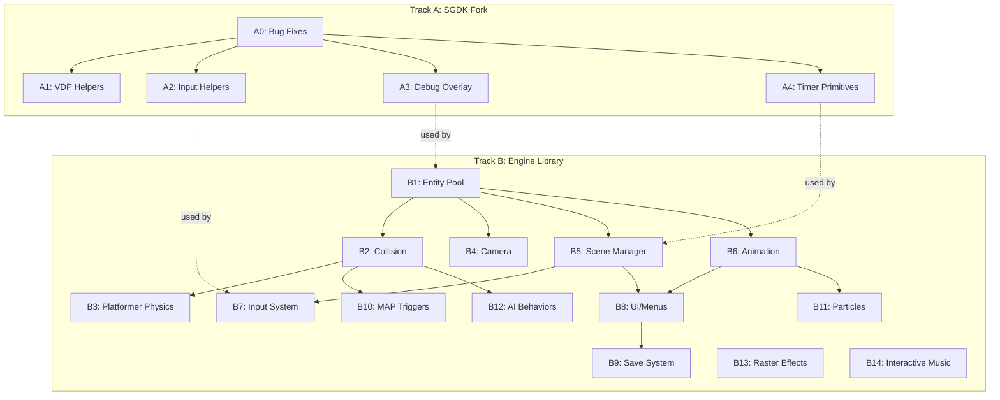

# SGDK Enhancement Roadmap

Two tracks: **lightweight improvements to the SGDK fork** (upstream-friendly) and a **separate game engine library** built on top of SGDK.

---

## Track A — SGDK Fork (Upstream-Friendly)

Low-level improvements that belong in the SDK itself. No architecture imposed, no opinions about how games should be structured. These could be submitted as PRs to the official SGDK repo.

### A0 — Bug Fixes

| Task | Issue | Status |
|------|-------|--------|
| Rescomp: Tiled object templates | [#466](https://github.com/Stephane-D/SGDK/issues/466) | **Done** |
| Team Player auto-detect fix | [#326](https://github.com/Stephane-D/SGDK/issues/326) | **Done** |
| Tilemap flip functions | [#461](https://github.com/Stephane-D/SGDK/issues/461) | **Done** |
| Retro-Bit controller timing | [#363](https://github.com/Stephane-D/SGDK/issues/363) | **Blocked** (needs hardware) |

### A1 — VDP Helpers

Additional low-level VDP functions that extend SGDK's tilemap/sprite API without imposing design:

- Tilemap region copy between planes
- Batch tile attribute update (set palette/priority on existing tiles)
- Sprite link list utilities

### A2 — Input Helpers

Thin stateless wrappers on `JOY_readJoypad()` — no buffering, no mapping, no RAM cost:

- `JOY_justPressed(port)` — edge-detect (pressed this frame, not last)
- `JOY_justReleased(port)` — released this frame
- `JOY_held(port, frames)` — button held for N frames

### A3 — Debug Overlay

Compile-time `#ifdef DEBUG` — zero ROM/RAM in release builds:

- CPU usage bar (cycles per frame)
- Free RAM display
- DMA queue depth
- Sprite count / entity count hooks (game provides the count)
- KLog wrappers with log levels

### A4 — Timer Primitives

Bare-metal frame-counting timers with no scene/state coupling:

- `TIMER_start(id)` / `TIMER_elapsed(id)` — measure frame intervals
- `TIMER_setAlarm(id, frames, callback)` — one-shot callback
- Fixed-size, no heap, no opinions about pause state

---

## Track B — Game Engine Library (Separate Repo)

> **Not part of the SGDK fork.** A separate library (`libgenesis-engine` or similar) that links against SGDK. Games choose which modules to include. Zero impact on games that don't use it.

### B1 — Entity Pool

- Fixed-size pool with O(1) alloc/free
- Component attachment (position, velocity, sprite, collision, custom)
- Optional sprite engine integration (opt-in, not automatic)
- Iteration primitives and pool stats

### B2 — Collision System

- Spatial grid (configurable cell size)
- Tilemap collision queries
- AABB/circle overlap, collision layers/masks
- `moveAndSlide()` collision response

### B3 — Platformer Physics (Optional Addon)

- fix16 gravity, acceleration, deceleration
- Slopes, coyote time, variable jump height
- Sensor system, physics state machine
- **Not linked unless explicitly included**

### B4 — Camera

- Lerp follow, dead zones, screen shake
- Room locking with transitions
- Genre presets (platformer, top-down)

### B5 — Scene Manager

- Scene stack with push/pop
- Per-scene lifecycle callbacks
- Transition effects (fade, wipe, iris)
- Scene-scoped resource management

### B6 — Animation Controller

- Data-driven frame sequences
- Frame callbacks (attack frame → event)
- Transition rules, chain/blend support

### B7 — Input System (Full)

- Action mapping (physical → logical buttons)
- Input buffering with configurable window
- Combo detection
- Remapping support

### B8 — UI & Menus

- Widget primitives (label, selector, toggle, slider)
- Menu stack with cursor navigation
- HUD layer, dialog boxes
- Window plane integration

### B9 — Save System

- Versioned save slots with checksum
- Corruption detection and recovery
- Save slot management UI
- Migration support (v1 save → v2 game)

### B10 — MAP Triggers

- Tiled object layer parsing via rescomp
- Runtime trigger detection and callbacks
- Spawn points, dynamic tile manipulation

### B11 — Particle System

- Dedicated particle pool (small struct, high count)
- Emitter presets (burst, stream, cone)
- Auto-recycle on lifetime expiry

### B12 — AI Behaviors

- Patrol, chase/flee, state machine framework
- Line-of-sight via tilemap collision
- Spawner patterns

### B13 — Raster Effects

- Declarative HBlank chaining
- Built-in effects (scroll wave, palette gradient, split-screen)

### B14 — Interactive Music

- Beat-synced section transitions
- Channel layering, stinger overlay
- Music state machine

---

## Dependency Graph

---

## Principles

- **Track A changes SGDK, Track B uses SGDK** — clean separation
- **Track A is upstream-submittable** — could become PRs to official SGDK
- **Track B is opt-in per module** — no module is mandatory, zero cost when not linked
- **Track B lives in its own repo** — independent release cycle, own test suite
- **Genesis-first** — every feature must fit in 68000 cycles and 64KB RAM
