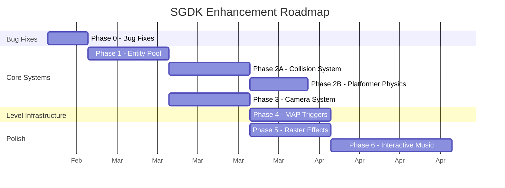

# SGDK Enhancement Roadmap

Combined plan for upstream bug fixes and new engine features. Every module is a **composable building block** — mix and match freely. A survivor/action-RPG hybrid uses Entity Pool + Spatial Grid + Tilemap Collision + Camera. A shmup with RPG segments adds MAP Triggers for town sections. No module assumes or excludes a genre.

---

## Phase 0 — Bug Fixes (Low-Hanging Fruit)

Quick wins that fix real issues for the community and build familiarity with SGDK internals.

| Task | Issue | Effort | Notes |
|------|-------|--------|-------|
| Rescomp: warn on Tiled object templates | [#466](https://github.com/Stephane-D/SGDK/issues/466) | ~1 day | Detect `template` attr in TMX parser, emit error. No template resolution needed yet. |
| Team Player auto-detect fix | [#326](https://github.com/Stephane-D/SGDK/issues/326) | ~1 day | Fix `JOY_reset()` to enable TP per-port independently. Needs careful default behavior consideration. |
| Tilemap flip functions | [#461](https://github.com/Stephane-D/SGDK/issues/461) | ~2 days | New `VDP_setTileMapExFlipped()` with reversed iteration + per-tile attribute toggling. |
| Retro-Bit controller timing | [#363](https://github.com/Stephane-D/SGDK/issues/363) | ~3 days | Add NOP delays in `TH_CONTROL_PHASE()`, retry logic in init. **Requires real hardware.** |

**Exit criteria:** Test ROMs built, verified in emulator (and hardware for #363).

---

## Phase 1 — Entity Pool System

> Generalize the entity/pool system from the survivor game into a reusable SGDK module.

- Fixed-size entity pool with O(1) alloc/free (free-list)
- Component-style data attachment (position, velocity, sprite, collision, custom)
- Iteration primitives: `ENTITY_forEach(mask, callback)`
- Automatic sprite engine integration: entity spawn → sprite allocated, entity kill → sprite released
- Pool stats API for profiling (active count, high watermark)

**Depends on:** Nothing — foundational system.
**Value for platformer:** Mario, enemies, items, projectiles, particles all managed uniformly.

---

## Phase 2A — Collision System (Genre-Agnostic Core)

> Universal collision detection layer usable by ANY game type.

- **Spatial grid** — configurable cell size, O(1) insert/remove, neighbor queries. Your survivor game's bread and butter.
- **Tilemap collision** — per-tile type flags (solid, slope, one-way, empty, custom). Query with `COL_checkTile(x, y)` → tile type + penetration vector.
- **Entity-vs-entity** — AABB and circle overlap tests via spatial grid
- **Collision layers/masks** — enemies don't collide with each other, bullets hit enemies but not player, etc.
- `COL_moveAndSlide(entity, velocity)` — generic movement with collision response (works for top-down AND side-scroll)
- Integrates with Entity Pool (Phase 1)

**Depends on:** Phase 1.
**Survivor value:** Spatial grid for bullet-vs-enemy at scale.
**Platformer value:** Tilemap collision for ground/walls/ceilings.

---

## Phase 2B — Platformer Physics Module (Optional Addon)

> Platformer-specific behaviors layered on top of Phase 2A. **Not linked unless used.**

- fix16 gravity, acceleration, deceleration, max velocity profiles
- Slope snapping, ceiling bonk, coyote time, variable jump height
- Wall/floor/ceiling sensor system (SMW-style: 2 floor sensors, 2 wall sensors, 1 ceiling)
- State machine: grounded, airborne, wall-slide, swimming, climbing
- Configurable physics profiles (swap between ground/air/water/ice constants)
- `PLAT_applyGravity(entity)`, `PLAT_jump(entity)`, `PLAT_moveOnSlope(entity)`

**Depends on:** Phase 2A (collision queries).
**Value:** 1:1 SMW physics. Refer to existing [SMW physics KI](file:///C:/Users/estee/.gemini/antigravity/knowledge/retro_platformer_physics_reference/artifacts/physics/smw_values.md) and [Genesis mapping KI](file:///C:/Users/estee/.gemini/antigravity/knowledge/retro_platformer_physics_reference/artifacts/portability/genesis_mapping.md) for exact constants.
**Survivor games ignore this module entirely.**

---

## Phase 3 — Camera System

> Reusable camera with common 2D behaviors. **Genre-agnostic by design.**

- Smooth lerp follow with configurable speed and dead zones
- Screen shake with decay
- Room/section locking with transition animations
- Integrates with MAP engine for scroll position
- **Platformer preset:** Snap-to-ground on landing, directional bias, L/R look-ahead
- **Top-down preset:** Centered follow with edge push, dual-axis dead zone

**Depends on:** Phase 1 (tracks entity position).
**Both genres benefit equally.**

---

## Phase 4 — MAP Engine v2 (Trigger System)

> Extend SGDK's existing MAP scrolling engine with event triggers from Tiled object layers.

- Parse Tiled object layers via rescomp into trigger arrays (position, size, type, properties)
- Runtime trigger detection: `MAP_checkTriggers(entity_x, entity_y)` → callback dispatch
- Trigger types: enter/exit zones, touch-once, repeatable, directional (warp pipes)
- Entity spawn points embedded in map data
- Dynamic tile manipulation: `MAP_setTile(x, y, newTile)` for ? blocks, breakable bricks
- Screen transition system (horizontal scroll, vertical scroll, door fade)

**Depends on:** Phase 1 (entity spawning), Phase 2 (collision detection context).
**Value for platformer:** Levels become data-driven. Place a "pipe-down" trigger in Tiled → pipe works. No per-level hardcoding.

---

## Phase 5 — Raster Effects Framework

> Declarative HBlank interrupt chaining for per-scanline effects.

- `RASTER_addEffect(startLine, endLine, callback)` — register scanline-range handlers
- Automatic HInt setup, priority sorting, minimal overhead when no effects active
- Built-in effect library: horizontal scroll wave, palette gradient, split-screen, water reflection
- Safe integration with VDP/DMA (no conflicts with tile transfers)

**Depends on:** Nothing technically, but lower priority than gameplay systems.
**Value for platformer:** Water levels, lava heat shimmer, gradient skies, ghost house fog — all declarative.

---

## Phase 6 — Interactive Music (XGM2 Extension)

> Context-sensitive music system on top of XGM2.

- Beat-synced section transitions (verse → chorus on next bar boundary)
- Channel layering: add/remove instrument tracks dynamically (Yoshi bongos pattern)
- Tempo scaling for star power / speed-up events
- Stinger overlay (coin sound over music without interrupting)
- Music state machine: define transitions in resource files, trigger from game code

**Depends on:** Deep understanding of XGM2 Z80 driver internals.
**Value for platformer:** Music that reacts to gameplay is defining for the genre.

---

## Module Composability

Genres blend. Modules are building blocks — pick what your game needs, not what a genre label says.

| Module | What it gives you |
|--------|-------------------|
| Entity Pool | Object lifecycle, pooling, iteration — **every game needs this** |
| Spatial Grid (2A) | Fast entity-vs-entity queries — any game with many colliding things |
| Tilemap Collision (2A) | Solid world geometry — any game with walls, floors, or obstacles |
| Platformer Physics (2B) | Gravity, slopes, jump arcs — opt-in for side-scroll movement only |
| Camera | Smooth scrolling — configurable per-axis, presets are suggestions |
| MAP Triggers | Event zones in world data — transitions, NPCs, items, cutscenes |
| Raster Effects | Per-scanline VDP tricks — water, gradients, distortion |
| Interactive Music | Context-reactive audio — intensity layers, seamless transitions |

> [!TIP]
> **Your survivor + Secret of Evermore hybrid** would use: Entity Pool + Spatial Grid + Tilemap Collision + Camera + MAP Triggers (town/dungeon transitions) + Interactive Music (combat intensity). Zero platformer physics needed — but if a future game adds platforming sections mid-RPG, just link Phase 2B for those segments.

---

## Suggested Timeline

> [!NOTE]
> Phases 2A and 3 parallelize. Phase 2B is optional — skip it entirely for non-platformers. Phase 4 only needs 2A, not 2B.

---

## Principles

- **Building blocks, not genre kits** — every API is opt-in. Modules compose freely for hybrid genres
- **Zero-cost when unused** — modules not linked = zero ROM/RAM overhead
- **Ship each phase as a usable module** — don't wait for Phase 6 to use Phase 1
- **Test with BOTH games** — survivor/RPG hybrid validates Entity Pool + Spatial Grid + Tilemap Collision + Camera. Platformer validates Physics + MAP Triggers
- **Upstream-friendly** — write in SGDK's existing code style, submit as PRs or maintain as a fork
- **Genesis-first** — every feature must fit in 68000 cycles and 64KB RAM
